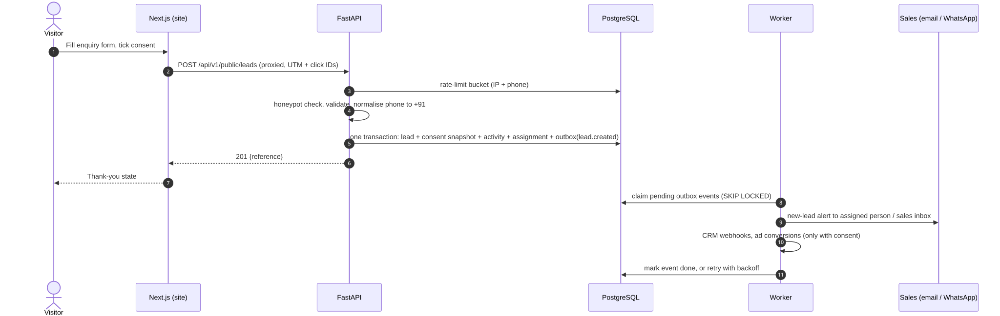
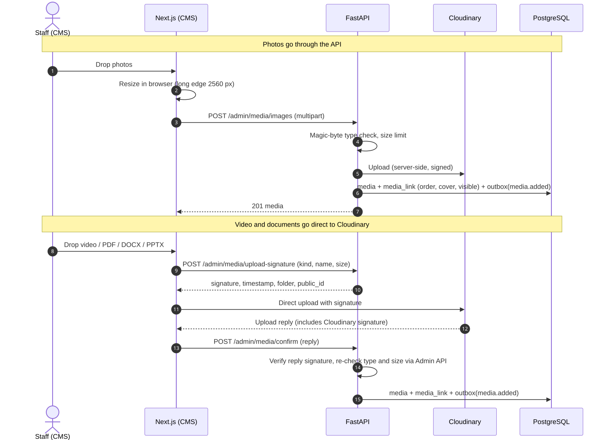

# Empire website and CMS: architecture

**Phase 1 deliverable** · 18 Oct 2026 · Status: for review
Related: [DECISIONS.md](DECISIONS.md) (why), [SECURITY.md](SECURITY.md), [api/openapi-v1.yaml](api/openapi-v1.yaml), [api/ENDPOINTS.md](api/ENDPOINTS.md), the owner's project brief (private, not in the repo)

Diagram sources are in `diagrams/src/*.mmd` (Mermaid); the `.svg` files next to them are rendered copies that open in any browser.

---

## 1. What we are building

- A public website at `https://empirebuildcon.com` for Empire, a **developer selling its own projects**, starting in **Uttar Pradesh** and able to add any state or city.
- A CMS at `/admin` that non-technical staff use to run projects, media, leads, pages, offers, SEO, users and settings.
- Extension points (events, webhooks, feature flags, a reserved chat slot) so marketing tools, a CRM, WhatsApp and an AI assistant can be added without rework.

## 2. Shape: a modular monolith, API-first

```
empire/                      (repo root = A:\Adarsh\Empire_RealEstate)
├─ apps/
│  ├─ web/        Next.js (App Router, TypeScript, Tailwind) — public site + CMS UI
│  └─ api/        FastAPI — /api/v1, SQLAlchemy 2, Alembic migrations; the background worker is the
│                 `empire-worker` entry point of the same package (D-010, D-026)
├─ packages/
│  ├─ ui/         Design system components built from brand/tokens (Phase 3; spec in handbook/DESIGN_SYSTEM.md)
│  └─ api-client/ Typed TypeScript client generated from the API's OpenAPI spec
├─ qa/            pytest + httpx (API), Playwright + axe (browser), Lighthouse CI
├─ handbook/      Developer guide: architecture, decisions, API, design system, git and code rules (D-025)
├─ brand/         Logo kit and design tokens (brand/tokens/empire-noir.json is the source for packages/ui)
├─ holding-page/  Static "coming soon" page for the domain check
├─ docs/          Owner's private notes — git-ignored, never in the repo (D-003, D-025)
└─ .github/workflows/  CI: lint, type-check, migrate, test, build
```

One PostgreSQL database. Each API module owns its tables, schemas, routes and events; modules talk to each other through service functions, never by reaching into another module's tables, and react to each other through events.



## 3. Request flow

1. Visitor opens `empirebuildcon.com` (DNS at Cloudflare). `www`, `empirebuildcon.in`, `empirebuildcon.co.in` and their `www` forms answer **308 → same path on `https://empirebuildcon.com`**, query string kept (D-008).
2. The web app serves pages. Public pages are pre-rendered and cached (§5).
3. The browser only ever calls **`/api/*` on the same site**. Next.js rewrites those calls to the API host. The browser never talks to the API host directly, so there is no CORS in production and the session cookie is first-party. The web app's proxy (`apps/web/src/proxy.ts`) adds a shared edge key and the visitor's IP; the API refuses calls without the key, so its host can't be used directly (D-027).
4. **No redirects on the API, ever.** FastAPI runs with `redirect_slashes=False` and a small ASGI middleware that strips a trailing slash before routing, so `/api/v1/admin/projects` and `/api/v1/admin/projects/` hit the same handler. Next.js sets `skipTrailingSlashRedirect: true` so the web host does not add its own 307/308 to `/api/*`. (This is the Current Investor production bug, fixed by design.) A CI test calls every route both ways and fails on any 3xx.
5. Server-side fetches from the web app to the API use a **3-second timeout**. On timeout the page renders its cached/static data and the client refetches (the API host can be slow to wake on free hosting).

## 4. Modules

| Module | Owns | Main endpoints | Emits |
|---|---|---|---|
| `projects` | Project, Tower, UnitConfiguration, Amenity, ProjectAmenity, Specification, LocationAdvantage, ConstructionUpdate, PaymentPlan(+Stage), City, Locality, Location | `/public/projects`, `/public/properties`, `/admin/projects/**`, `/admin/maps/resolve` | `project.*`, `configuration.changed`, `construction_update.published` |
| `listings` | Listing (resale/rent) | reserved; **flag `listings` off** — not built in v1 (D-004) | `listing.*` |
| `media` | Media, MediaLink | `/admin/media/**`, `/admin/media-links/**` | `media.*` |
| `leads` | Lead, LeadConsent, LeadNote, LeadActivity, SiteVisit, Notification | `/public/leads`, `/public/site-visits`, `/public/brochure-requests`, `/admin/leads/**`, `/admin/site-visits/**`, `/admin/reports/utm` | `lead.*`, `site_visit.*` |
| `content` | Page, Block, Post, Faq, Offer, Testimonial, ConsentText; the schedule tick | `/public/pages`, `/public/posts`, `/public/faqs`, `/public/testimonials` (Phase 5), `/admin/pages/**`, `/admin/posts/**`, `/admin/faqs/**`, `/admin/testimonials/**`, `/admin/offers/**`, `/admin/consent-texts/**` | `page.*`, `post.*`, `faq.changed`, `offer.*`, `testimonial.changed`, `consent_text.published` |
| `seo` | Redirect; `seo` JSON checks and warnings on content rows; public paths; sitemap feed | `/public/redirects`, `/public/sitemap` (Phase 5), `/admin/redirects/**` | `redirect.changed` |
| `users` | User, Session, PasswordResetToken (roles are a code matrix, §11) | `/auth/**`, `/admin/users/**`, `/admin/roles`, `/admin/audit-log` | `user.*` |
| `settings` | Setting, FeatureFlag | `/public/site`, `/admin/settings/**`, `/admin/flags/**` | `settings.updated`, `flag.changed` |
| `integrations` | WebhookEndpoint, WebhookDelivery, integration config; outbox handlers and the drain | `/admin/integrations/**`, `/admin/webhooks/**`, `/internal/outbox/drain` | — (delivers events) |
| `ai` | KnowledgeChunk (pgvector), ChatConversation, ChatMessage | `/ai/chat` (**flag `chat_widget` off**) | — |
| `platform` (shared) | RateLimitBucket, AuditLog, OutboxEvent (tables and writers), crypto helpers, i18n helpers | `/api/health` | — |

Full list: [api/ENDPOINTS.md](api/ENDPOINTS.md) (159 operations).

## 5. Rendering and caching

| Page type | How it renders | Refreshes when |
|---|---|---|
| Home, project list, project detail, property list/detail, city pages, blog, pages, legal | Static generation + incremental revalidation, tagged (`project:<slug>`, `projects`, `properties`, `page:<slug>`, `posts`, `site`) | The worker calls the web app's signed `/_internal/revalidate` with tags after a publish event; plus a 1-hour safety revalidate |
| Search/filter results | Server-rendered from URL query (`?city=noida&bhk=3`) so links can be shared; cached briefly at the edge | Every request (short cache) |
| CMS (`/admin/**`) | Client-rendered after a server session check; never cached | Always live |
| Lead forms, chat | Client components posting to `/api/v1/public/*` | — |

The `/_internal/revalidate` route lives outside `/api/*` so it is handled by Next.js, not proxied. It requires an HMAC-SHA256 signature (`X-Revalidate-Signature`) computed over the timestamp and raw JSON body (`${timestamp}.${body}`) using `REVALIDATE_SECRET`, along with `X-Revalidate-Timestamp`. Signatures older than 5 minutes or previously observed are refused (D-039). An API outbox handler (`integrations/handlers.py`) sends this request on CMS publish events with automatic retries.

## 6. Data model







**Conventions**

- **IDs:** UUID v7 (time-ordered) for most tables; `bigint` identity for high-volume append tables (audit log, outbox, webhook deliveries).
- **Timestamps:** `timestamptz`, stored in UTC, shown in IST.
- **Money:** whole rupees in `bigint` (`price_min_inr`, `price_max_inr`, `rate_inr`). Display formats as ₹ 85 L, ₹ 1.25 Cr. `price_on_request` hides numbers everywhere, including structured data.
- **Area:** stored once in **square metres** (`size_min_sqm`, `size_max_sqm`) with `display_unit` (sq ft, sq yd, sq m) and `area_basis` (carpet, built-up, super built-up, plot). RERA pages show carpet area where available.
- **Ranges:** every price and size is a min/max pair; equal values display as a single figure.
- **Formatted text:** descriptions, FAQ answers, payment plan notes use WhatsApp-style text (`*bold*`, `_italic_`, `-` bullets, two-space nesting). Stored as plain text; rendered by our own parser into React elements. Raw HTML is never rendered.
- **Translations (D-014):** English lives in the normal columns. A `translations` JSON column holds overlays per locale, e.g. `{"hi": {"name": "…", "tagline": "…"}}`. Missing translations fall back to English.
- **SEO:** a `seo` JSON column on projects, configurations, pages, posts and cities: title, description, OG image, noindex, canonical path.
- **Media links (exclusive arc):** `media_link` has one nullable foreign key per owner type (project, configuration, construction update, page, post) and a check constraint that exactly one is set. Real foreign keys, cascades on delete, one table to query. A partial unique index allows one cover per owner and role.
- **Public paths:** `/` is the home page, `/<slug>` a page, `/blog/<slug>` a post, `/projects/<slug>` a project, `/projects/<slug>/<config-slug>` one of its configurations ("property"), `/properties` every configuration and `/cities/<slug>` a city's projects (D-041). `apps/api/src/empire_api/seo/paths.py` and `apps/web/src/lib/public/catalogue.ts` hold the same rules. Redirects and the sitemap use these. The website renders pages from their resolved blocks (task 5.5a, D-045).
- **Publishing:** content rows have `publish_state` (draft, published, archived). Projects and configurations also have `sales_status`: **available**, **sold_out** (shown after available items with a "Sold out" badge), **off_market** (hidden from the public site).
- **Sample data (D-015):** rows created by the sample seed carry `is_sample = true`. Public endpoints never return them in production, publish is blocked for them in production, and the CMS shows a "Sample" badge.
- **Deletion:** projects with leads, and pages and posts that were ever published, are archived, not deleted. Offers that were ever live stay too (switch them off). Leads are never hard-deleted by staff; `leads.erase` (super-admin) replaces personal fields with a stub on a data-erasure request and logs it.
- **Units:** the `unit` table (individual flats) is not built in v1 (D-005). Availability is tracked per configuration.

**Content (Phase 4 part 4, D-035)**

- **Pages** have a kind: `standard`, `landing`, `legal` or `system`.
  - System pages (home, projects, about, contact) are seeded and can't be created. They and the seeded legal pages (privacy, terms, disclaimer) are *required pages* (`is_required`): they can't be deleted or archived, and keep their slug and kind. Unpublishing is allowed.
  - A few slugs are reserved for the site's own sections (`admin`, `api`, `blog`, `projects`, `properties`, `search`, `sitemap`, locale prefixes and so on).
  - COMPLIANCE (D-017): legal pages need `legal.publish` to publish, unpublish, schedule, archive, delete, edit while live *or scheduled*, or change kind to or from legal. Production refuses to publish text still marked `[DRAFT`, the same test as consent texts; it also refuses to leave such text on a live legal page, or to move it into or out of the legal kind.
  - A live page can't be given a publish time, and taking a page down clears its publish time, so a stale one never brings the page back.
  - Saving a page or its blocks may send `expected_updated_at`; if someone saved in between, the save is refused with 409 instead of overwriting their change.
- **Blocks** are ordered rows on a page. `PUT /pages/{id}/blocks` saves the whole ordered list in one transaction. There are 17 types, each with a strict data shape (a discriminated union on `type`):
  - hero, rich_text, image, gallery (≤ 24), video, project_grid, property_grid, cta, lead_form, faq_list, stats, testimonials, offer_banner, map, steps (≤ 8), columns (2–3) and divider.
  - SECURITY: no text field accepts HTML. Links must be a site path or `https://` with a host; `javascript:`, `data:`, `http:`, `//host` and similar are refused. Videos come from a YouTube/Vimeo host allowlist and are stored as provider plus id.
  - Every id a block names (media, project, city, FAQ, testimonial, offer) is checked, and read `FOR SHARE` so a concurrent delete can't slip past. Photos in hero, image and gallery blocks need an honest label (D-033).
  - When a deleted FAQ or testimonial was the last one a block picked, the block is hidden: an empty pick list would otherwise mean "all site-wide FAQs" or "the newest testimonials".
  - A project that a page block or an offer names can't be deleted (409 names where).
  - COMPLIANCE: each stat needs a `source` and an `as_of` date that isn't in the future.
- **Posts:** blog and news, with a FormattedText body, cover image (with an honest label), category, tags and author.
- **FAQs:** site-wide or per project, ordered, with show/hide. Showing one needs `content.publish`. A project's FAQs appear in `ProjectAdmin.faqs`.
- **Offers:** placement banner, home or project; a computed state (scheduled, live, ended, inactive).
  - New offers start switched off. The image needs an honest label; a project placement always names its project (CHECK).
  - COMPLIANCE: no countdown field exists, and pressure wording ("only N left", "hurry", "last few") is refused. When the text mentions a price or discount, a terms line or T&C link is required.
  - An offer that has been live, or that a page shows, can't be deleted.
- **Testimonials:** real only. A database CHECK stops one being shown without a `source` and `consent_date`. There is no sample flag, and the seed creates none.
- **Redirects:** every active redirect is one hop.
  - Chains collapse (A→B with B→C stored saves A→C, and redirects to A are re-pointed), keeping the original target's query string and fragment when the new target has none; a loop is refused with 409. Writes take an advisory lock.
  - `to_path` is a site path, or `https://` on one of our domains, stored as its path; a path starting with `//` is refused, with a CHECK as backstop. Default 308.
  - A redirect typed in the CMS can't start at the address of a live page, post or project (409).
  - Paths match exactly and case-sensitively (Phase 5 contract); only the reserved-path check ignores case.
  - A slug change on a live project, page or post creates or re-points a redirect from the old path. Publishing an item removes any redirect *from* its own path, so renaming back and forth can't loop.
- **SEO JSON** is checked everywhere it appears: title ≤ 70 and description ≤ 170 (no HTML), an image for `og_image_id`, an internal `canonical_path` (no whitespace or control characters). Changing it needs `seo.manage`. The API also returns `seo_warnings` for the CMS checklist: a missing title or description, a title over 60 or a description over 160 characters (where search results cut them), and noindex. Warnings never block.
- **Translations** of pages, posts and FAQs refuse HTML, and every translated field keeps its English length limit.
- **Seed:** `empire-api seed` creates the system pages and the legal pages (privacy, terms, disclaimer) as required drafts with a clear DRAFT placeholder. `seed --sample` adds one SAMPLE post, one SAMPLE offer (switched off) and SAMPLE FAQs; it never adds testimonials.

**Indexes worth naming now:** unique `slug` per table; `lead(created_at desc)`, `lead(status, created_at desc)`, `lead(owner_user_id, created_at desc)`, `lead(phone_e164)`; `project(publish_state, sales_status)`; GIN on `project.search_vector` (generated `tsvector`) and `pg_trgm` on project and locality names; `outbox_event(status, available_at)`.

## 7. Listing visibility and order (public site)

1. Central visibility helper (`empire_api.public.visibility`) enforces rules across all public endpoints.
2. Only `publish_state = published`, `is_sample = false` (in production, D-015), and `sales_status != off_market`.
3. Bracketed `[placeholders]` in settings/copy are sanitized to `null` in production, and preserved elsewhere for inspection.
4. Sort: `available` before `sold_out`; within each group, featured order, then the chosen sort (recommended = possession date, then newest).
5. A project page always shows the **RERA authority, registration number, QR code and the regulator's website** (D-002). Phase-wise registrations show per tower/phase.
6. **Hero/cover image selection rule (D-038):** pinned cover if visible and labelled with an honest label; else first visible labelled gallery photo in sort order; else none.
7. **Area display:** carpet area comes first, in both sq ft and sq m, calculated from stored square metres.
8. **Price display:** "excludes GST, stamp duty and registration" note; `price_on_request` suppresses all numeric prices.

## 8. Lead handling



- **Intake:** one endpoint per intent: enquiry, site-visit request, brochure request. All accept UTM fields and click IDs (`gclid`, `gbraid`, `wbraid`, `fbclid`, `msclkid`). The site keeps them from the landing address in the browser tab's session storage (first touch for the session; no cookie, nothing sent to a third party) and sends them with the lead (task 5.4, D-043).
- **Phone:** normalised to E.164 (`+91XXXXXXXXXX`). Accepted forms include `98765 43210`, `+91-98765-43210`, `09876543210` and `919876543210`.
  - Mobiles are 10 digits starting 6–9.
  - Landlines must include the STD code: 10 digits starting 1–5 after the trunk 0.
  - Foreign numbers aren't accepted yet (`TODO(phase-6)` for NRI leads).
  - "Fancy" numbers (repeated digits, runs) are valid, because operators sell them.
  - The rule follows the DoT National Numbering Plan (D-034).
- **Consent:** the form shows the current consent text. The lead stores the text id, version, time, page URL and the exact checkbox label shown. A lead without consent is rejected.
  - A stale version gets 409 (reload the page).
  - Until an approved text is published, intake answers 503.
  - Marketing consent is a separate, optional record. It is never assumed.
  - Manual leads carry the staff member's note on how consent was given.
  - Consent texts live in the content module. They are versioned and never edited after publishing, and a draft-marked text can't be published in production (D-017).
- **Spam:**
  - A filled honeypot gets the same 201 answer with a look-alike reference, and nothing is stored.
  - Rate limits: 5 per 10 minutes per network (IPv6 by /64) and per phone hash, in PostgreSQL.
  - Duplicates: the same phone and project within 24 hours is saved, linked to the earlier lead (`duplicate_of_id`) and given to the same owner. Its `lead.created` event has `alert: false`, so no second alert goes out.
  - Captcha comes only if spam gets through (flag `captcha`).
- **General leads:** `project_id` may be empty (contact page, NRI page).
- **Website forms (task 5.4, D-043):** one client component (`components/leads/LeadForm.tsx`) for the enquiry, site-visit and brochure intents, on the project page (enquiry, site visit, gated brochure), the property page (enquiry with `configuration_id`, none when sold out) and `/contact` (site visit and enquiry with a project choice; `?project=` preselects).
  - It posts through the site's `/api` proxy, so the API sees the visitor's network for its rate limit. That needs JavaScript. Without it, and with no current lead-form text, the visitor sees call and WhatsApp links instead of the form.
  - `page_url` is the path only. The referrer is sent without its query.
  - A gated brochure: the project answer says `brochure_gated: true` only when there is a brochure to give, without its address. The address comes back from `/public/brochure-requests` after the form.
- **Assignment (D-016):** in the same transaction as the insert, using `settings.lead_routing`: `single` (everything to one person or the sales inbox), `round_robin` (in turn among listed sales users), or `manual`. Default: single → sales inbox.
- **Pipeline:** new → contacted → site_visit → negotiation → booked / lost (lost needs a reason). Every change writes a `lead_activity` row.
- **Inbox:** newest first, paged, read/unread, with filters in the URL. Dashboard counts link to the filtered inbox (e.g. "12 new" → `/admin/leads?status=new`).
  - INVARIANT: every count shows the same number as the list it opens. The count and the list share one query, with filters such as `open` (still being worked: not booked, lost or erased), `utm_source`/`utm_medium` for the UTM report, `open` on site visits (requested or confirmed) and `blocked` on projects (drafts that can't be published yet). A browser test clicks each count and compares.
- **Object-level access:** without `leads.read_all`, staff see only leads they own. Duplicate links are scoped the same way, and a manual lead links only to an earlier lead its creator can see. This covers the list, detail, notes, activity, visits, export and dashboard. Anyone else's lead answers 404. The UTM report shows counts only; for sales it covers their own leads.
- **Export:** CSV (`leads.export`), streamed and guarded against spreadsheet formulas, with a UTF-8 BOM so Excel shows Hindi names.
  - It is capped at 50,000 rows. Bigger requests are refused, never silently cut.
  - Each export is audited, and each exported lead's timeline records it.
- **Erasure:** `leads.erase` replaces personal fields, notes, the IP hash, consent page URL and stored event payloads with a stub. The reference, status, dates and consent metadata are kept. Leads are never hard-deleted.
- **Retention:** the daily clean-up anonymises leads with no real activity for `privacy.lead_retention_years` (default 3). Reads and exports don't count as activity.
- **Projects with leads** can't be deleted, only archived.
- **Alerts:** email at launch; WhatsApp in Phase 6 (needs WhatsApp Business API).

## 9. Events and the outbox

Every important change writes an `outbox_event` row **in the same transaction** as the change. The worker claims pending rows (`FOR UPDATE SKIP LOCKED`), delivers them, and marks them done or schedules a retry (1 min, 5 min, 30 min, 2 h, 6 h, 24 h, then `dead` with an alert). New features subscribe to events; core code does not change.

Envelope: `{id, type, occurred_at, actor_id, aggregate: {type, id, slug}, data}`. Personal data is included only in `lead.*` and `site_visit.*` events, and only sent to webhook endpoints marked "may receive personal data".

| Event | Emitted when | Consumers |
|---|---|---|
| `project.published` / `project.updated` / `project.unpublished` | Publish, edit while published, unpublish | Revalidate project, lists, properties, cities, sitemap · webhooks · AI index (Phase 7) |
| `configuration.changed` | Any configuration edit on a published project | Revalidate project + properties |
| `construction_update.published` | Update goes live | Revalidate project · webhooks |
| `media.added` / `media.updated` / `media.removed` | Upload, reorder, cover, show/hide, delete | Revalidate the owner if published |
| `media.upload_discarded` | A direct upload was refused or never confirmed | Destroy the file at the store (retried) |
| `lead.created` | Lead saved (`data.alert` is false for duplicates and manual leads) | Email alert to `lead_routing.inbox_email`, or every active super-admin when it is empty (only when `data.alert` is true) · WhatsApp alert (flag) · CRM webhooks · Meta Conversions API + Google Ads conversion (only with marketing consent and flag on) |
| `lead.status_changed` / `lead.assigned` | Pipeline move / owner change | CRM webhooks · email to new owner |
| `site_visit.requested` / `site_visit.updated` | Visit form / CMS change | Sales alert · webhooks |
| `page.published` / `page.unpublished` / `page.updated` | Incl. scheduled publish; `updated` for edits while live | Revalidate page, nav, sitemap · AI index |
| `post.published` / `post.unpublished` / `post.updated` | | Revalidate blog, sitemap · AI index |
| `faq.changed`, `testimonial.changed` | | Revalidate · AI index (FAQs) |
| `offer.started` / `offer.ended` / `offer.changed` | Scheduler tick or edit | Revalidate banners |
| `settings.updated`, `flag.changed`, `redirect.changed`, `consent_text.published` | | Revalidate `site` tag |
| `web.revalidate` | Independent retry after revalidation delivery failure (M2) | Revalidate Next.js cache tags with dedicated backoff |
| `user.setup_link_issued`, `user.password_reset_requested` | Invite, resend, forgot password | Email the link (decrypted only in the handler, never logged) |
| `user.locked`, password changed, `user.two_factor_enabled` / `_disabled` / `_reset` | | Security notices to that user (lock notices at most once an hour) |

**Email (D-036).** Handlers send through one interface with two transports: Resend (`POST https://api.resend.com/emails` over `httpx`, with an `Idempotency-Key` from the event, template and recipient) in staging and production, and a dev mailbox (`apps/api/.mail-dev/`, never sends) in development and tests. A local `email_message` log (keyed hashes, no content) stops a retried event from sending twice after Resend's 24-hour key memory. Rate limits, quota (Free plan: 100 a day, resetting at midnight UTC), auth and server errors are retried on the outbox schedule; other 4xx answers go dead at once with an alert line. Dead emails show on the dashboard ("N emails couldn't be sent"). Templates are plain text plus simple HTML: no images, remote fonts or tracking.

## 10. Background jobs

| Job | Frequency | Notes |
|---|---|---|
| Outbox drain | Inside the request right after commit for time-critical events (3 s budget), plus a sweep every 15 minutes | Lead alerts go out within seconds; the sweep retries failures. Every 15 minutes (not every minute) so the free database can sleep (D-007) |
| Schedule tick | Every 15 minutes, before every drain (worker loop and the internal drain endpoint) | Scheduled page publish/unpublish and offer start/end; each change is announced once. A scheduled publish that is blocked (for example a legal page still marked draft) is cancelled and audited |
| Clean-up | Daily | Expired sessions, reset tokens, old rate-limit buckets, stale upload intents, and anonymising leads past the retention period |
| Backup export | Daily | Only if the database plan has no automatic backups (D-007) |
| Knowledge index | On publish events | Phase 7 |

The worker is one Python function set with two entry points: a long-running loop (paid, always-on hosting) and an HTTP-triggered `/api/v1/internal/outbox/drain` (free hosting, called by a scheduler with `X-Internal-Key`). Same code either way (D-010).

## 11. Roles and permissions

Five roles. One super-admin at launch: `admin@empirebuildcon.com` (the owner). Permissions are checked in the API on every call; the CMS hides what a role cannot do.

| Permission | Allows | Super-admin | Admin | Sales | Marketing | Content editor |
|---|---|:-:|:-:|:-:|:-:|:-:|
| `dashboard.view` | Dashboard | ✓ | ✓ | ✓ | ✓ | ✓ |
| `projects.read` | See projects in the CMS | ✓ | ✓ | ✓ | ✓ | ✓ |
| `projects.write` | Edit projects, towers, configurations, cities, amenities | ✓ | ✓ | | | ✓ |
| `projects.publish` | Publish / unpublish projects | ✓ | ✓ | | | |
| `projects.delete` | Delete draft projects | ✓ | ✓ | | | |
| `media.upload` | Upload, attach, order, cover, show/hide | ✓ | ✓ | | ✓ | ✓ |
| `media.manage` | Delete from the library | ✓ | ✓ | | | ✓ |
| `leads.read` | Open leads assigned to them | ✓ | ✓ | ✓ | | |
| `leads.read_all` | See every lead | ✓ | ✓ | | | |
| `leads.update` | Status, notes, details, manual leads | ✓ | ✓ | ✓ | | |
| `leads.assign` | Change a lead's owner | ✓ | ✓ | | | |
| `leads.export` | CSV export (audited) | ✓ | ✓ | | | |
| `leads.report` | UTM report (counts only, no personal data) | ✓ | ✓ | ✓ | ✓ | |
| `leads.erase` | Erase personal data on request | ✓ | | | | |
| `site_visits.manage` | Visit calendar | ✓ | ✓ | ✓ | | |
| `content.read` / `content.write` | Pages, blocks, posts, FAQs, testimonials | ✓ | ✓ | | ✓ | ✓ |
| `content.publish` | Publish pages, posts, FAQs, testimonials | ✓ | ✓ | | ✓ | ✓ |
| `legal.publish` | Legal pages and consent texts | ✓ | ✓ | | | |
| `offers.manage` | Offers and banners | ✓ | ✓ | | ✓ | |
| `seo.manage` | SEO fields, redirects | ✓ | ✓ | | ✓ | ✓ |
| `settings.read` | See settings | ✓ | ✓ | | ✓ | |
| `settings.write` | Company, contacts, lead routing | ✓ | ✓ | | | |
| `marketing.tracking` | GTM, GA4, Pixel, Ads IDs | ✓ | ✓ | | ✓ | |
| `flags.manage` | Feature flags | ✓ | ✓ | | | |
| `integrations.manage` | Webhooks, CRM, alerts | ✓ | ✓ | | | |
| `audit.read` | Audit log | ✓ | ✓ | | | |
| `users.manage` | Accounts and roles | ✓ | | | | |

**Settings groups** each check their own permission (`x-permission-by-group` in the OpenAPI spec): company, contacts, social, lead routing, regulator and email need `settings.write`; tracking needs `marketing.tracking`; SEO defaults need `seo.manage`; privacy (lead retention) needs `settings.write` and the super-admin role. The route itself is marked `settings.read`, so marketing can save tracking (D-036).

Every create, update, delete, publish, export, login and permission change writes an `audit_log` row (who, what, before/after diff, IP). The CMS shows the IP masked.

## 12. Media



- **One storage interface, two stores (D-033).**
  - `CloudinaryStore`, using the official SDK, is used in staging and production. Those environments refuse to start without `CLOUDINARY_URL`.
  - `FakeStore` is for development, tests and the browser suite. It keeps files on disk and mimics Cloudinary's signed direct upload, so the whole flow runs offline. Its `/api/v1/dev-media/**` routes exist only when it is active.
- **Photos go through the API.**
  - The browser resizes and re-encodes them first: long edge 2560 px, WebP or else JPEG at about 0.85 quality. The RERA QR is kept as lossless PNG.
  - The web proxy is allowed bodies of 10 MB + 64 KB (`experimental.proxyClientMaxBodySize` in `apps/web/next.config.ts`). Next.js would otherwise cut larger bodies off silently, instead of the API answering 413.
  - The API checks magic bytes (JPEG, PNG, WebP or AVIF only; no SVG), size (≤ 10 MB) and pixels (≤ 25 MP).
  - It strips EXIF/GPS and other metadata, uploads to the store under a generated public id `empire/<env>/<kind>/<uuid>`, and saves the row. The uploaded filename is never used.
- **Videos and documents** (PDF, DOC/DOCX, PPT/PPTX) go **directly from the browser to Cloudinary**:
  1. The API creates an `upload_intent` and signs the upload for that one public id. The intent is valid for 60 minutes, belongs to the user and can be used once. `overwrite=false` is signed too.
  2. The browser uploads and sends Cloudinary's reply to `confirm`.
  3. The API checks the reply signature, matches the intent, re-reads the asset from the Admin API (type, bytes) and only then saves it.
  - Anything refused or never confirmed is destroyed through the outbox.
  - Free-plan limits (checked 23 Oct 2026): 10 MB images and raw files, 100 MB video, 25 MP. Only 40 MB of video can be transformed on the fly, so the video poster is made eagerly at upload.
- **What files can be attached to.** A `media_link` attaches library items to one owner: a project, configuration, construction update, page or post.
  - **Project roles:** `gallery`, `video`, `document`, `brochure` (PDF) and `rera_qr`. `hero` and `og_image` are reserved: the share image is `seo.og_image_id`, and the hero waits for Phase 5.
  - **Configuration role:** `floor_plan` (image or PDF).
  - **Construction update role:** `gallery` (progress photos).
  - **Page and post roles:** `block` and `cover`. They are internal: the content API keeps them in step with the page's blocks and the post's cover, and the media-links endpoints refuse to change them (D-035).
  - Offer images and testimonial photos are restrictive foreign keys, not links.
  - Single-valued roles (brochure, RERA QR, floor plan) replace the previous item.
- **Order, cover and visibility.**
  - Staff set the order. The first *visible* photo is the cover unless another is pinned.
  - Each item can be shown or hidden on the website and renamed.
  - Photos carry an honest label: artist's impression, actual photo, or progress photo with its month. Gallery and hero photos can't be shown on the website without one.
  - A library item can't be deleted while it is attached, used as a share image, or used by a page block, post cover, offer or testimonial. The 409 names up to five places, and `GET /admin/media/{id}/usage` lists them all; a testimonial is named by the person's initials only.
  - Renaming or relabelling an item revalidates every live project, page, post, offer and shown testimonial that uses it.
- **RERA QR.** The project's visible `rera_qr` image is what clears the publish blocker. It can't be hidden or removed while the project is live; replace it instead.
- **One drop zone** in the CMS sends each file to the right uploader by type.
- **Delivery** uses Cloudinary transformations (`f_auto,q_auto`, width steps). Every delivered image URL carries a transformation, which also strips metadata.
  - PDFs are stored as images, so they open in the browser and get a page-1 thumbnail.
  - Office files are stored as raw files and download.
  - Public pages use `next/image` with a custom loader (Phase 5).
- **Owner action:** new Cloudinary accounts block PDF delivery until **Settings → Security → "Allow delivery of PDF and ZIP files"** is on.

## 13. Maps

- Staff paste a Google Maps link, a `maps.app.goo.gl` short link or a plus code, and the API extracts the pin (`POST /api/v1/admin/maps/resolve`):
  - **Long links:** the coordinates are read from the URL, in this order: the place pin `!3d…!4d…`; the `q=`, `query=`, `destination=` and `ll=` values; `/maps/search/<lat>,<lng>` and `/maps/place/<lat>,<lng>` (the usual target of a shared dropped pin); and finally the map centre `@lat,lng`.
  - **Short links:** followed on the server only, under the rules in SECURITY.md §5.
  - **Full plus codes** (e.g. `7JWV8XX8+XX`): decoded by our own port of Open Location Code, tested against Google's official vectors (D-031).
  - **Short plus codes** (`8XX8+XX Noida`): refused, with a message asking for the full code or a Maps link.
- Staff can also type the pin. Dragging the pin on a map arrives with the map component in Phase 5.
- The site shows the pin with **Leaflet 1.9.4 + OpenStreetMap** tiles, loaded only when the visitor presses "Show map". The pop-up gives the project name, address, RERA number and a "Get directions" link to Google Maps. The address and the directions link are always on the page, so the map is never the only way to find the site (task 5.3, D-041).
  - **OpenStreetMap tile policy** (checked 2 Nov 2026): HTTPS tile URL only, visible attribution, the browser's normal Referer, no bulk or offline use, and no service level. Phase 9 check: if traffic grows, move to a paid tile provider and change the CSP `img-src` host with it.

## 14. Search

- PostgreSQL full-text search (generated `tsvector` on project name and tagline, combined with city and locality in queries) plus `pg_trgm` for typos, and structured filters (status, city, locality, type, BHK, budget). Filters live in the URL.
- PostgreSQL generated columns cannot reference foreign tables, so `project.search_vector` indexes `name` and `tagline` directly on the project row, while search queries combine this with tsvector expressions and `pg_trgm` word similarity operators (`<%`) on `city.name` and `locality.name`, accelerated by GIN indexes on `project(search_vector)`, `project.name`, `locality.name`, and `city.name` (migration `0007_search.py`, Task 5.1, D-038). Replaces text-match `LIKE` in public catalogue search, while admin project search pairs full-text and trigram matching with `LIKE` on slug and name and orders by relevance (exact match first, then prefix, then substring LIKE, then full-text rank, trigram similarity, and updated_at) when `q` is given.
- The `vector` extension (pgvector) is enabled by the first migration wherever the server has it (Neon, CI and the Docker image do), so Phase 7 needs no database change (D-013). A bare local PostgreSQL without pgvector still works until Phase 7 (D-026).

## 15. Languages

English at launch. `next-intl` routing is set up with `en` as the default (no prefix) and `hi` ready under `/hi/...`, switched on by flag `locale_hi` once Hindi content exists. Slugs stay English for both locales; `hreflang` alternates go in the sitemap (D-014).

## 16. SEO

- Metadata per page (`lib/public/seo.ts` `pageMetadata`, task 5.6, D-047):
  - Title, description and canonical URL on `https://empirebuildcon.com` (`SITE_URL`). The CMS's SEO fields come first; a filtered list's canonical is the list itself.
  - Open Graph and Twitter card. The share image is the CMS's share image, else the cover or first image (Cloudinary crop to 1200×630), else the logo on black (`public/brand/share-default.png`).
  - Nothing is indexed until go-live (Phase 9).
- Structured data (`components/JsonLd.tsx`, with the CSP nonce):
  - Types: `Organization` (home page), `RealEstateListing` for projects and homes, `FAQPage`, `BreadcrumbList`.
  - The RERA number is the identifier. There is no price when the price is on request, and no data for samples or placeholders.
- `sitemap.xml` (split by type) and `robots.txt` (task 5.6b). Clean slugs; breadcrumbs on every inner page.
- Redirects:
  - A redirects manager in the CMS (301/308). Redirects are one hop, never loop, and are created automatically on slug changes (§6, D-035).
  - The web app's proxy (`proxy.ts`, `lib/public/redirects.ts`) answers them for GET and HEAD, with the list cached 60 s per server process.
  - Each redirect served is counted through the signed `POST /api/v1/internal/redirects/hit` (`seo/hits.py`).
- Pages, posts and projects carry a `seo` JSON; the CMS shows the API's `seo_warnings` as a checklist.

## 17. Marketing and consent hooks (Phase 6, structure now)

- A consent banner with three choices (necessary, analytics, marketing). GTM/GA4 and Meta Pixel load only after the matching consent; IDs come from Settings, so they can be switched on without a deploy.
- Server-side conversions (Meta Conversions API, Google Ads enhanced conversions) are outbox consumers on `lead.created`, sent only when the lead's marketing consent is true. Phone/email are SHA-256 hashed before sending.
- Campaign landing pages are CMS pages of kind `landing` built from blocks, with their own lead form and `noindex` option.
- WhatsApp click-to-chat on every page (mobile sticky bar) with a prefilled message naming the page.

## 18. AI-ready layer (Phase 7, structure now)

- A chat-widget slot in the layout, lazy-loaded only when flag `chat_widget` is on (off by default).
- `/api/v1/ai/chat` answers 404 while the flag is off.
- Knowledge index (`knowledge_chunk` with embeddings) built from published projects, FAQs, pages and brochures on publish events.
- Tools the assistant may call: search projects, get RERA details, request a site visit, capture a lead with consent, hand over to WhatsApp or a person. Guardrails: no price promises, no legal or financial advice, every answer cites a page. Model provider behind an interface so it can be swapped.

## 19. Environments and hosting

| Environment | Purpose | Where |
|---|---|---|
| Local / Claude's workspace | Development and tests | Any machine with PostgreSQL, or `docker compose up -d db` (PostgreSQL 18 + pgvector); see [SETUP.md](SETUP.md) (D-019, D-026) |
| Staging | Owner review at milestones and gates | Netlify (web) + Cloud Run (API) + Neon branch `staging` |
| Production | Live site | Same providers, separate Neon branch/project and Cloud Run service; free first, step-ups listed in D-007 |

| Piece | Provider (D-007) |
|---|---|
| Web app | Netlify |
| API + worker | Google Cloud Run + Cloud Scheduler |
| Database | Neon (PostgreSQL 18) |
| Media | Cloudinary |
| Outgoing email | Resend |
| DNS, redirects, inbound email, holding page | Cloudflare |
| Errors / uptime | Sentry / UptimeRobot |
| Backups | GitHub Actions (encrypted daily `pg_dump`) |

## 20. Observability

- Sentry for the web app (`@sentry/nextjs@11.10.0`) and API (`sentry-sdk`), release-tagged from CI. The web app's `beforeSend` scrubber strips query strings, fragments, request bodies, cookies and visitor IP addresses before transmission (D-039). Setting `NEXT_PUBLIC_SENTRY_DSN` empty disables Sentry locally and in test environments.
- Uptime checks every 5 minutes on `/` and `/api/health/live` (answers without touching the database, so the free database can sleep), alerting the owner by email. `/api/health` (with a database check) runs after each deploy.
- Structured JSON logs (request id, user id, route, status, duration). No passwords, tokens or full phone numbers in logs (phones masked `+91 98xxxxxx10`).

## 21. Testing (QA suite, built from Phase 3)

| Layer | Tool | Runs |
|---|---|---|
| API | pytest + httpx against a real PostgreSQL | Every push (CI service container) |
| Contract | Schemathesis against the OpenAPI spec; "no 3xx on any API path" test | Every push |
| Browser journeys | Playwright: lead form, CMS login, project edit → publish → visible on site, media upload | Every push (smoke), full nightly |
| Accessibility | axe via Playwright on every template | Every push |
| Performance | Lighthouse CI (mobile) ≥ 90 for performance, accessibility, best practices, SEO | On main |
| Visual | Playwright screenshots, mobile + desktop | Before each gate |

The browser suite signs in as few times as possible: a Playwright setup project signs in the super-admin and a sales user once each and saves their sessions to `qa/.auth/` (git-ignored); the journeys reuse them. With the sign-in tests and the account journeys (an invited admin's first sign-in and a two-factor sign-in), a run uses 6 sign-ins, because the API allows 10 per network in 15 minutes, successful ones included (D-027). Locally that is one full run per 15 minutes. The two-factor code step doesn't count toward that limit. Emails go to the dev mailbox, which the journeys read through `/api/v1/dev-mail/latest` (development and test only); password-reset requests use a fresh address each run. Public lead intake is limited too (5 per 10 minutes per network), so a run makes four public submissions (one API call and three through the website forms) and adds other test leads through the staff API (`qa/README.md`).
